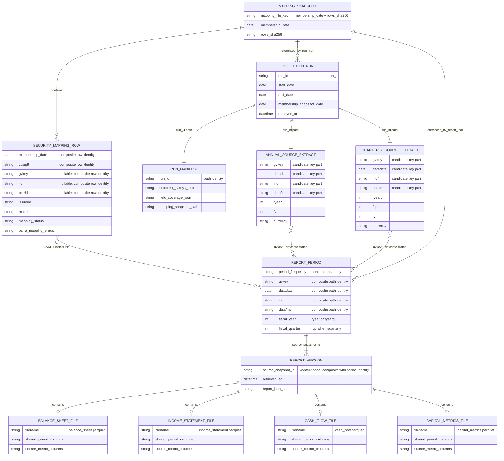

# sf-data-pipelines-quant

Data pipelines built by the Silver Fund Quant team for BYU Research Computing.

## Setup

### 1. Clone the repository

```bash
mkdir -p ~/projects
cd ~/projects
git clone https://github.com/BYUSilverFund/sf-data-pipelines-quant.git
cd sf-data-pipelines-quant
```

Run the remaining commands from this directory.

### 2. Install dependencies

If `uv` is not installed:

```bash
curl -LsSf https://astral.sh/uv/install.sh | sh
source ~/.bashrc
```

Install dependencies and activate the environment:

```bash
uv sync
source .venv/bin/activate
```

To run the repository's offline regression suite, include the development
dependency group, which installs pytest:

```bash
uv sync --group dev
```

Activate the environment again whenever you open a new terminal.

### 3. Configure `.env`

For a new installation:

```bash
cp example.env .env
nano .env
```

If `.env` already exists, edit it without replacing your settings.

Fill in these values:

```bash
USERNAME=your_research_computing_username
ROOT=/home/${USERNAME}
PROJECT_ROOT=/home/${USERNAME}/projects/sf-data-pipelines-quant

WRDS_USER=your_wrds_username
BYU_EMAIL=your_email@byu.edu

DATABASE_ENV=development
```

Adjust `PROJECT_ROOT` if you cloned the repository elsewhere.

Valid databases are `development`, `research`, and `production`.
`DATABASE_ENV` sets the wrapper's default; `--database` selects the
database for an individual Python command.

Do not commit `.env` or credentials.

### 4. Check access and configuration

Your account needs access to `grp_quant` and `grp_msci_barra`.

```bash
groups
.venv/bin/python scripts/check_env.py
```

Request any missing group access and resolve reported errors before running pipelines.

## WRDS and Duo

FTSE Russell and CRSP require a working WRDS account.

1. Sign in at https://wrds-www.wharton.upenn.edu/.
2. Complete account activation and Duo Mobile setup if prompted.
3. Set `WRDS_USER` in `.env`.
4. When running a WRDS pipeline, enter your WRDS credentials and approve the Duo push if requested.

Your WRDS credentials might differ from your BYU credentials.
Password characters might not appear while typing.

See the [WRDS Duo instructions](https://wrds-www.wharton.upenn.edu/pages/about/log-in-to-wrds-using-two-factor-authentication/).

## Running Pipelines

Run heavy updates and backfills within a Slurm compute allocation.
See [DEVELOPER.md](DEVELOPER.md) for submission instructions.

### Daily Update

Choose the database you want to update:

```bash
python -m pipelines barra update --database development
```

Replace `development` with `research` or `production` as needed.

The update runs:

1. Daily Barra datasets and asset mappings.
2. Assets.
3. Signals, scores, and alphas.
4. Composite alphas.
5. Optimal weights.

Existing historical assets files are skipped, while the current year
is rebuilt. Signals, scores, alphas, and composite alphas are
recalculated from the full available assets history.

Optimal weights fill missing dates from the last 30 days. Use the
optimal weights backfill for history.

This command does not refresh FTSE Russell or CRSP.

### FTSE Russell Backfill

If the database is missing FTSE Russell files, run:

```bash
python -m pipelines ftse backfill --database development
```

After it succeeds, retry the daily update for the same database.

Without date options, FTSE backfill requests July 31, 1995 through today.
WRDS authentication and Duo approval might be required.

### Barra Backfill

To rebuild a historical date range:

```bash
python -m pipelines barra backfill \
    --database development \
    --start 2026-01-01 \
    --end 2026-10-12
```

Adjust the database and dates as needed. This is separate from the
daily update and does not automatically run signals.

### Signals, Scores, and Alphas Only

To recalculate these outputs using existing assets:

```bash
python -m pipelines signals backfill --database development
```

This processes the full available assets history. The current
implementation does not use `--start` or `--end` to limit processing.

### Composite Alphas Only

The composite alpha is the equal-weight average of the
`barra_momentum`, `barra_reversal`, `ivol`, and `beta` alphas. A missing
alpha counts as 0.

To recalculate composite alphas using existing alphas:

```bash
python -m pipelines composite-alphas backfill --database development
```

Without date options, this processes July 31, 1995 through today.

`pipelines/weighted_composite_alphas_flow.py` keeps the Bayesian-weighted
research version. It is not part of the daily update and writes to
`weighted_composite_alphas`.

### Optimal Weights Backfill

Optimal weights use sf-quant's `dynamic_mve_optimizer` with a 5% active
risk cap against a market-cap benchmark. The portfolio is fully
invested, long-only, and has the benchmark's beta.

To fill historical dates:

```bash
python -m pipelines optimal-weights backfill \
    --database development \
    --start 2026-01-01 \
    --end 2026-10-26
```

Only dates without weights are computed, so an interrupted backfill
can be rerun. To recompute a year, delete its
`optimal_weights_<year>.parquet` file first. Run full history on Slurm.

### Help

```bash
python -m pipelines --help
python -m pipelines barra --help
python -m pipelines ftse --help
python -m pipelines signals --help
python -m pipelines composite-alphas --help
python -m pipelines optimal-weights --help
```

## Common Problems

- **Missing `ftse_russell_*.parquet` files:** run FTSE backfill for the same database, then retry Barra.
- **Missing `sf_quant` attribute or unexpected keyword argument:** sf-quant is older than 0.2.9. Run `uv sync`.
- **`Optimization failed`:** a date could not be solved. Earlier years are kept. Fix the data, then rerun.
- **WRDS authentication failed:** check your WRDS credentials, account status, and Duo setup.
- **WRDS connection closed:** check for a Duo request. A connection issue or authentication timeout could also cause this.

Do not include passwords or tokens when sharing error logs.

## Data Storage

Data is stored as yearly Parquet files under:

```text
/home/<username>/groups/grp_quant/database/
```

Each database has its own directory: `production`, `development`, or `research`.

Legacy CRSP tables (`crsp_daily`, `crsp_monthly`, `crsp_events`) end in 2024, because WRDS no longer updates the legacy format. For 2025 onward use `crsp_v2_daily` and `crsp_v2_monthly` (`sf_quant.data.load_crsp_v2_*`). `crsp_v2_daily` has `primaryexch` and `securitytype` in place of the events table's exchange and share codes. Legacy backfills warn and skip years with no source rows instead of writing empty files.

Fama-French 5-factor data is a single file, `<database>/ff5_factors/ff5_factors.parquet`, which is the path `sf_quant.data.load_fama_french()` reads.

## Ticker to Barra ID lookup

Use the saved `assets` table to resolve ticker symbols to Barra IDs. This table
contains ticker, Barrid, company name, and mapping date for each saved snapshot.
The lookup normalizes ticker case and surrounding whitespace and keeps every
matching security row; it does not choose among multiple Barrids. By default,
it uses the latest saved snapshot. Pass `as_of` to select the latest saved
snapshot on or before a date.

```python
from pipelines.barra_lookup import find_barra_id
from pipelines.utils.enums import DatabaseName

result = find_barra_id(" AAPL ", database=DatabaseName.DEVELOPMENT)
print(result.mapping_date)  # Snapshot date used, even if there is no match
print(result.matches)       # Polars DataFrame: ticker, barrid, name, mapping_date

historical = find_barra_id("AIR", database="development", as_of="2020-06-30")
if historical.found:
    print(historical.matches)
else:
    print(f"No match for {historical.ticker} on {historical.mapping_date}")
```

To query a ticker from the command line:

```bash
.venv/bin/python -m scripts.find_barra_id AAPL --database development
.venv/bin/python -m scripts.find_barra_id AIR --database development --as-of 2020-06-30
```

The helper reads only the selected environment's saved Parquet data. Its
`matches` frame is empty when the ticker is absent from the selected snapshot;
`mapping_date` reports the snapshot date used. An as-of query uses the latest
available snapshot not later than the requested date, so the result reflects
the saved mapping at that snapshot rather than a vendor lookup. Multiple
matches are retained; for example, the saved 2024-01-02 snapshot has two `ARC`
rows:

```bash
.venv/bin/python -m scripts.find_barra_id ARC --database development --as-of 2024-01-02
```

## Compustat Fundamentals

Collect annual and quarterly Compustat North America data without SEC access:

```bash
python -m pipelines compustat \
    --source-database development \
    --start 2024-01-01 \
    --end 2026-10-29 \
    --limit 5
```

`--limit` selects the first eligible GVKEYs in sorted order. The command reads
the latest stored FTSE Russell 1000/2000 union, maps exact CUSIP9 identifiers
through date-effective `comp.sec_idhist` intervals, and attaches the existing
date-effective Barra CUSIP-to-`barrid` and `barrid`-to-issuer/root relationships.
The full security-level many-to-many mapping is saved separately, including
unmatched securities and multiple IIDs or Barra IDs. Compustat statements are
fetched once per unambiguous GVKEY; missing CIK metadata does not block that
collection. Ambiguous GVKEY or CIK mappings are excluded from automatic
collection and remain in the mapping snapshot. Compustat's universe mapping
does not use ticker matching.

### Quant query tables

The query tables are derived, yearly Parquet files in the selected pipeline
environment. Development is the initial target. The builder reads only a
completed Compustat collection and its immutable archived report versions. It
requires the exact mapping snapshot and membership date recorded by that run,
and an explicit version policy (`latest` follows each report's saved
`latest_snapshot.json`; a specific policy supplies one snapshot ID per report).
The builder rejects runs without a successful `completion_report.json` and
materializes only the validated `INDL/C/D/STD` series. Other-format counts are
kept in the query manifest and are never merged into these tables.

After the collector and its completion audit have finished, materialize a
completed run with:

```bash
.venv/bin/python -m scripts.build_compustat_query_tables \
    --compustat-root "$ROOT/groups/grp_quant/database/fundamentals/compustat" \
    --run-id run_<completed-run-id> \
    --mapping-snapshot "$ROOT/groups/grp_quant/database/fundamentals/compustat/security_mappings/<snapshot-recorded-in-run.json>.parquet" \
    --mapping-date 2026-08-31 \
    --version-policy latest \
    --target-database development
```

The mapping file must be the exact saved file recorded in the selected run's
`run.json`; the date must match its `membership_snapshot_date`. The default
target is `development`; `research` and `production` are separate destinations.
The output paths are
`$ROOT/groups/grp_quant/database/<environment>/fundamentals_annual/` and
`fundamentals_quarterly/`, partitioned by the calendar year of `datadate`.
The manifest is `compustat_query_manifest.json` in that environment's database
directory. It records source runs, mapping snapshot/date, selected extraction
versions, filters, row counts, excluded formats, unresolved mappings, and key
checks. Its materialization ID isolates run, mapping, and actual extraction
version choices. Repeating the same scope is idempotent. A different scope is
rejected unless `--rebuild-scope` explicitly replaces both derived tables in
that environment. The source report archive is not changed.

For a specific-version build, use `--version-policy specific --versions-file
versions.json`. That JSON file maps each report identity to its saved snapshot
ID; keys have the form
`annual|<gvkey>|<datadate>|<indfmt>|<consol>|<popsrc>|<datafmt>` or
`quarterly|...`. The file must name exactly the report identities in the
selected run.

### Quant quickstart

Run the checked-in example against the saved development data:

```bash
.venv/bin/python examples/compustat_quickstart.py
```

The script initializes `Database(DatabaseName.DEVELOPMENT)` and reads the
annual, quarterly, and assets tables. It calculates annual operating
profitability as `oiadp / at`, annual revenue growth only when the prior
`fyear` is present, and displays quarterly `oancfy` with `fyearq`, `fqtr`,
`fyr`, and `currency`. `sale`, `at`, `oiadp`, and cash-flow amounts are in
millions of reported currency; the currency column identifies that currency.
Source snapshot IDs and report paths remain alongside calculated results.
Other annual fields include balance-sheet items such as `act`, `che`, `dltt`,
and `seq`; income items such as `sale`, `cogs`, `gp`, `ni`, and `xrd`; and
cash-flow items such as `oancf`, `capx`, and `fincf`. Quarterly equivalents
include `atq`, `saleq`, `niq`, and YTD cash-flow fields such as `oancfy` and
`capxy`. The full field lists, fiscal labels, and provenance columns are in
[Physical schemas and logical ERD](#physical-schemas-and-logical-erd).

The default date policy selects the latest saved assets date on or before
today, scanning yearly asset files backward from the requested date's year.
Pass `--asset-date YYYY-MM-DD` to select another saved snapshot. For the join, the
example chooses one latest annual fiscal-year row per Barrid, requires unique
asset Barrids at the selected date, and validates a one-to-one join. Separate
Barrids that map to the same GVKEY remain separate share-class securities.

`fyear`, `fyearq`, `fqtr`, and `fyr` are source fiscal labels; `datadate` is
the reporting period date. Quarterly cash-flow fields ending in `y`, including
`oancfy`, are fiscal-year-to-date amounts, not standalone quarter amounts.
The saved Compustat values are current vendor data, not historical
point-in-time vintages. Filtering `datadate` to a past asset date does not
establish when the report became available and does not make the output safe
for historical backtesting. The query tables remain separate from daily
assets and signals.

### Reviewed SEC operating-cash-flow fallback

The development database has a separate policy/input-scoped resolved
quarterly table. The reusable OCF-YTD collector and extractor keep candidate
discovery separate from acceptance. Candidate configuration must establish
issuer identity and consolidation scope; a CIK match alone cannot pass that
gate. Only reviewed `accepted` candidates with an exact accession, period,
fiscal labels, concept, currency/unit, filing value, scale conversion, and
cutoff can fill a null `oancfy`. Original Compustat columns and non-null values
are retained. SEC YTD values remain labeled YTD.

Build the reviewed full-universe development output with an explicit
timezone-aware policy cutoff and the versioned review artifact:

```bash
.venv/bin/python -m scripts.build_development_fundamentals \
    --cutoff 2026-10-29T23:59:59+00:00 \
    --run-id run_e906597c98025ac25cdf006d \
    --review-artifact docs/sec_ocf_full_universe_candidate_review_v1.json
```

The reviewed development scope is
`554ee70eae30809295529849ef67eea627ae928ccb1d34cddcf76fb47ab08190`. It has
31,789 quarterly rows, preserves all 30,805 non-null Compustat `oancfy` values,
and contains six accepted company-periods represented by six SEC-filled Barra
rows. Open it through `Database` and query the supplemented rows:

```python
import polars as pl
from pipelines.utils.enums import DatabaseName
from pipelines.utils.tables import Database

scope = "554ee70eae30809295529849ef67eea627ae928ccb1d34cddcf76fb47ab08190"
resolved = Database(DatabaseName.DEVELOPMENT).fundamentals_quarterly_resolved_table(scope)
supplemented = (resolved.read()
    .filter(pl.col("selected_source") == "sec")
    .select("gvkey", "barrid", "datadate", "resolved_oancfy", "sec_value_raw",
            "sec_accession", "selection_reason", "candidate_evidence_json")
    .sort(["datadate", "gvkey"]).collect())
print(supplemented)
```

The generic build validates full-universe accounting dynamically as discovered
periods = classified periods + pending periods; it does not assume a fixed
candidate total or acceptance count. In the reviewed source run, 977 periods
reconcile to 976 classified plus one pending CIK `0001569650`.

Run the development stages with the same explicit inputs:

```bash
.venv/bin/python -m scripts.build_development_fundamentals \
    --cutoff 2026-10-29T23:59:59+00:00 \
    --run-id run_e906597c98025ac25cdf006d \
    --review-artifact docs/sec_ocf_full_universe_candidate_review_v1.json
```

It checks the completed source-run reports, reuses a matching validated query
scope or builds the query tables, regenerates the bounded candidate report from
archived SEC responses, builds the resolved scope, then verifies the output
through `Database`. It does not fetch SEC data or wait on unreviewed
candidates; those remain null. If the source run or mapping scope changes, the
query builder protects existing development tables by default. Pass
`--rebuild-query-scope` only when you intend to replace that development query
scope.

The six accepted periods are Brandywine Realty Trust, BrightSpire Capital,
Vanda Pharmaceuticals, and Syntec Optics FY2024 Q1–Q3. The output has 978
remaining null resolved values; the pending CIK `0001569650` remains
unresolved because its Company Facts 404 does not establish no disclosure. No
new SEC requests or Compustat reruns were needed. This output uses
current-vintage data and the comparison cutoff above; it is not historical
point-in-time data. See
[`SEC_FALLBACK_HANDOFF.md`](SEC_FALLBACK_HANDOFF.md) for classifications,
source and output checksums, preservation checks, and limitations.

Annual query-table keys add `(fyear, fyr)` to
`(barrid, gvkey, datadate, indfmt, consol, popsrc, datafmt, mapping_date,
mapping_snapshot_id, source_snapshot_id, materialization_id)`. Quarterly keys
add `(fyearq, fqtr, fyr)` to that same base. The fiscal labels are necessary
because the retained source contains multiple quarterly fiscal periods for
some identical GVKEY/date/format identities. Exact full-row duplicates are
collapsed in the derived build; the source extracts are preserved. Distinct
fiscal-period rows are retained, and conflicting rows with the same fiscal key
are quarantined and mark the build `partial`. A GVKEY can map to multiple
Barrids, but repeated IID/CUSIP relationships for the same Barrid/GVKEY are
collapsed before statement rows are joined. The table's environment path
isolates development, research, and production. The manifest locks each
environment to one materialization scope and records both the mapping
snapshot and actual extraction IDs selected by `latest`, so later versions
cannot silently mix with existing files.

The local lookup helper reads the saved date-effective security mapping and
Compustat report archive by Barrid. It requires an explicit mapping date and
preserves mapping ambiguity, report versions, and source metadata.

For a single saved metric, use the Barrid lookup. It requires an explicit
`mapping_date`; that date selects an exact saved membership snapshot and is
separate from the reporting fiscal year/quarter and the optional
`information_available_as_of` backtest cutoff. The function is local and
read-only; it never starts a collection. When a report has multiple versions,
choose an exact `source_snapshot_id` or explicitly pass `"latest"`:

```python
from datetime import date
from pipelines.ibkr_fundamentals_lookup import lookup_compustat_metric_by_barrid

result = lookup_compustat_metric_by_barrid(
    "/path/to/fundamentals/compustat",
    barrid="USA91R1",
    mapping_date=date(2026, 8, 31),
    fiscal_year=2024,
    frequency="quarterly",
    fiscal_quarter=1,
    statement="cash_flow",
    metric="oancfy",
    information_available_as_of=date(2025, 1, 1),
    source_snapshot_id="latest",
)
if result["status"] == "ok":
    print(result["value"], result["units"], result["currency"])
```

The result includes the resolved GVKEY, mapping snapshot and effective
intervals, reporting date, source table and field, period semantics, source
Parquet path, extraction version, and extraction time. Status values distinguish
unmapped or ambiguous Barrids, missing reports, unavailable fields, null values,
multiple matching reports, and multiple extraction versions. `"latest"` follows
the saved report's latest-version pointer; omitting a version does not choose
among multiple saved versions. Historical effective intervals may support a
relationship at the reporting date, but the membership snapshot itself is not
a historical mapping vintage. The saved Compustat values are current vendor
data, not historical point-in-time vintages; `information_available_as_of` is
returned as a separate backtest date and does not establish historical
availability.

For the completed full Russell materialization, exact pilot query results,
output paths, duplicate handling, and presentation-ready examples, see
[PRESENTATION_HANDOFF.md](PRESENTATION_HANDOFF.md).

The output root defaults to
`$ROOT/groups/grp_quant/database/fundamentals/compustat/`; override it with
`--output-root`. Each collection keeps annual and quarterly source extracts
and a run manifest. Report folders use GVKEY and calendar year of `datadate`:

```text
compustat/
  security_mappings/membership_<date>_<hash>.parquet
  source_extracts/run_<hash>/{annual,quarterly}.parquet
  source_extracts/run_<hash>/{run.json,coverage_report.json}
  source_extracts/run_<hash>/completion_report.json  # detached-run artifact audit
  2026/gvkey_001000/annual_2026-06-30_INDL_STD/
    report.json
    balance_sheet.parquet
    income_statement.parquet
    cash_flow.parquet
    capital_metrics.parquet
    snapshots/<source-hash>/...
  2026/gvkey_001000/quarterly_2026-09-30_INDL_STD/...
```

### Physical schemas and logical ERD

These are separate Parquet and JSON files, not normalized database tables.
Parquet has no enforced primary or foreign-key constraints; composite identities
below describe the collector's paths and logical joins.

- A mapping file is keyed by its path, `membership_<membership_date>_<rows_sha256>.parquet`.
  Its 22 columns are `membership_date`, `cusip9`, `russell_1000`,
  `russell_2000`, `gvkey`, `iid`, `cik`, `compustat_efffrom`,
  `compustat_effthru`, `mapping_source`, `cik_source`, `mapping_status`,
  `gvkey_candidate_count`, `cik_candidate_count`, `iid_candidate_count`,
  `barrid`, `issuerid`, `rootid`, `instrument`, `barra_start_date`,
  `barra_end_date`, and `barra_mapping_status`. A candidate relationship row
  identity is `(membership_date, cusip9, gvkey, iid, barrid)`; `gvkey`, `iid`,
  and `barrid` can be null for unresolved candidates.
- A collection directory is keyed by `run_id`; it contains `run.json`,
  `annual.parquet`, `quarterly.parquet`, and `coverage_report.json`. The coverage
  report summarizes row counts, report-date and fiscal-year ranges, companies
  with no reports in the requested window, per-field null counts, duplicate
  composite report identities, unavailable schema fields, and excluded-format
  counts. It leaves the reason for an empty company unverified. The manifest records selected
  GVKEYs, date range, filters, field definitions and missing fields, coverage
  limitations, and the mapping snapshot path. Its physical JSON keys are
  `eligible_gvkey_count`, `end_date`, `excluded_format_counts`,
  `field_definitions`, `fields_missing_from_schema`, `filters`,
  `format_limitation`, `mapping_snapshot`, `membership_snapshot_date`,
  `point_in_time_vintage`, `requested_items_unavailable`, `retrieved_at`,
  `run_id`, `selected_gvkey_count`, `selected_gvkeys`, `source_database`,
  `source_tables`, `start_date`, and `report_identity_fields`. Source rows have
  identity `(gvkey, datadate, indfmt, datafmt)` within their frequency file.
  The 50-company expansion run had 114 annual and 521 quarterly rows. The
  full Russell run `run_bd766d2869a3a83fce895048` covers 2,949 eligible GVKEYs
  from the 2026-08-31 membership snapshot for 2024-01-01 through 2026-10-29:
  6,261 annual rows and 30,336 quarterly rows, representing 6,261 and 30,324
  unique report identities. Twelve quarterly duplicate rows share a composite
  identity and are retained in the source extract under one report period.
  Annual coverage is 2,948 companies (one has no annual observation in-window);
  quarterly coverage is all 2,949 companies. The empty annual case's reason is
  unverified.
  Its `completion_report.json` checked all 36,585 report identities, with no
  missing reports or artifacts, no identity mismatches, and matching sampled
  source-to-report values. The report also records actual sample output schemas.
- Each report period path has composite identity
  `(period_frequency, gvkey, datadate, indfmt, datafmt)`. New period folder
  names include both format codes, for example
  `annual_2025-05-31_INDL_STD`. Older folders without these suffixes remain
  readable; their `report.json.format_filters` identifies the format. The
  report's `fiscal_year` is taken from source `fyear` for annual data or
  `fyearq` for quarterly data; `fyr` is the fiscal year-end month. The calendar
  year directory comes from `datadate` and does not define fiscal year.
- Each period's `snapshots/<source_snapshot_id>/` is a content-addressed
  extraction version. The per-period version key is
  `(period_frequency, gvkey, datadate, indfmt, datafmt, source_snapshot_id)`.
  This hash is distinct from the collection `run_id`. `latest_snapshot.json`
  points to one version; `report.json` inside that selected version is its
  metadata source.
- Current schema-2 report versions contain four separate statement Parquet
  files; older retained versions can omit newer files such as `cash_flow.parquet`
  and `capital_metrics.parquet`. A missing artifact is version-specific and
  does not make the period unreadable. Each artifact has shared columns
  `gvkey`, `datadate`, `fyear`, `fyr`, `fqtr`, `fyearq`, `currency`, `rdq`,
  `indfmt`, `consol`, `popsrc`, and `datafmt`, plus the source fields listed
  below. These fields carry the report's composite identity; they do not
  contain `run_id` or `source_snapshot_id` columns. `report.json` stores the
  fiscal period, `indfmt`/`datafmt` identity, source-table identity,
  extraction/version metadata, field definitions, units, missing-schema
  fields, and mapping references; the source `fyear`/`fyearq` and `fyr` values
  remain in each statement row. Current schema-2 report JSON keys include
  `indfmt` and `datafmt` in addition to `announcement_date_available_in_source_table`,
  `announcement_date_field`, `balance_sheet_values_are`, `calendar_year`,
  `capital_metrics_period_semantics`, `cash_flow_values_are`,
  `company_metadata_basis`, `company_name`, `datadate`,
  `debt_change_limitation`, `field_groups`, `fiscal_quarter`, `fiscal_year`,
  `format_filters`, `format_limitation`, `gvkey`,
  `income_statement_values_are`, `mapping_references`, `period_frequency`,
  `period_start`, `point_in_time_vintage`, `requested_items_unavailable`,
  `retrieved_at`, `schema_version`, `source_field_definitions`,
  `source_field_labels`, `source_field_units`,
  `source_fields_missing_from_schema`, `source_record_count`,
  `source_snapshot_id`, `source_table`, `ticker`, `tickers`, and `units`.

The current series' verified report-artifact metric columns are:

| File | Annual fields | Quarterly fields |
|---|---|---|
| `balance_sheet.parquet` | `act, at, che, dlc, dltt, invt, lct, lt, ppent, rect, seq` | `actq, atq, cheq, dlcq, dlttq, invtq, lctq, ltq, ppentq, rectq, seqq` |
| `income_statement.parquet` | `cogs, dp, epsfx, epspx, gp, ni, oiadp, pi, sale, txt, xint, xrd, xsga` | `cogsq, dpq, epsfxq, epspxq, gpq, niq, oiadpq, piq, saleq, txtq, xintq, xrdq, xsgaq` |
| `cash_flow.parquet` | `capx, cdvc, chech, dlcch, dltis, dltr, dpc, fincf, ivncf, oancf, pdvc, prstkc, prstkcc, prstkpc` | `capxy, cdvcy, chechy, dlcchy, dltisy, dltry, dpcy, fincfy, ivncfy, oancfy, pdvcy, prstkccy, prstkcy, prstkpcy` |
| `capital_metrics.parquet` | `cshfd, csho, cshpri, dvc, dvp, dvpd, dvpsp_f, dvpsx_f, dvt` | `cshfdq, cshoq, cshprq, dvpq, dvpspq, dvpsxq` |

Quarterly `gpq` is a nullable placeholder in report files because it
was absent from the connected source schema; report metadata marks it
unavailable. Source extracts contain the union of these fields plus source
currency fields (`curcd` or `curcdq`) and normalized `currency`. They also
contain compatibility columns: annual extracts include null `fyearq`/`fqtr`,
and quarterly extracts include null `fyear`.
In the full Russell run, `dvpd` was null in all 6,261 annual rows. Annual
`FS/STD` (1,184 rows) and `INDL/SUMM_STD` (5,753 rows) were counted in coverage
metadata but excluded from this series. Quarterly `gpq` is present only as a
null placeholder in report artifacts; it was unavailable in the source schema.

The ERD separates those logical entities from the actual file layout. A row in
a report artifact joins to its source observation by `(gvkey, datadate,
period_frequency, indfmt, datafmt)`. A report joins to security relationships through `gvkey`
and the mapping file path plus selected rows in `report.json.mapping_references`;
there is no mapping foreign-key column in the statement Parquets. A report
version joins to zero or one of each artifact by its containing snapshot
directory; schema-2 versions have all four, while older versions may not.



The collector selects `indfmt=INDL`, `consol=C`, `popsrc=D`, and `datafmt=STD`
for `comp.funda` and `comp.fundq`, after checking the connected table schemas
for the requested columns. These select industrial, consolidated, domestic,
standardized observations. Financial-services (`FS`) and other formats are
excluded and their observed counts are reported. See [WRDS Compustat filters
and format definitions](https://wrds-www.wharton.upenn.edu/pages/wrds-research/macros/wrds-macros-market-book-ratios/).

Balance-sheet values are period-end instants. Annual income fields are
durations; quarterly income fields use Compustat's quarterly `q` names.
Cash-flow fields are in `cash_flow.parquet`; quarterly cash flows retain the
source `...y` fiscal-year-to-date values. The WRDS `QUARTERIZE` macro confirms
that cash-flow items in `fundq` are YTD and income-statement items are quarterly.
This collector does not derive standalone quarters. Shares and dividend
measures are in `capital_metrics.parquet`. `csho`/`cshoq` are period-end shares
outstanding; `cshpri`/`cshprq` and `cshfd`/`cshfdq` are basic and diluted
weighted-average shares. These are separate source concepts.

Verified annual cash-flow fields are `oancf`, `ivncf`, `fincf`, `capx`, `dpc`,
`chech`, `cdvc`, `pdvc`, `dltis`, `dltr`, `dlcch`, `prstkc`, `prstkcc`, and
`prstkpc`.
The corresponding quarterly YTD fields are `oancfy`, `ivncfy`, `fincfy`,
`capxy`, `dpcy`, `chechy`, `cdvcy`, `pdvcy`, `dltisy`, `dltry`, `dlcchy`,
`prstkcy`, `prstkccy`, and `prstkpcy`. `prstkc`/`prstkcy` retain Compustat's combined
common-and-preferred repurchase item alongside separate cash-flow components.
Cash dividends paid (`dvpd`) are distinguished from declared dividend totals
(`dvc`, `dvp`, `dvt`) and the cash-flow dividend components. Long-term debt
issuance and reduction are separate; current-debt movement is only available as
a net change (`dlcch`/`dlcchy`). Dividend-per-share fields preserve their
pay-date or ex-date source basis.

Additional income statement fields are `xint`/`xintq` (interest and related
expense), `txt`/`txtq` (income taxes), `pi`/`piq` (pretax income), and
`dp`/`dpq` (depreciation and amortization expense). Cash-flow D&A (`dpc`/`dpcy`)
is retained separately. No gross profit, EBIT, free cash flow, or standalone
quarter values are derived. Quarterly `DVPD`, `DVC`, and `DVT` counterparts are
unavailable in `fundq`; the manifest records these gaps and the available
`CDVCY`/`PDVCY` cash-flow components remain YTD. Per-field labels, units, source
currency, nulls, missing-schema fields, and period semantics are recorded in
each report's metadata. Monetary values use millions of reported currency,
share counts use millions of shares, and per-share metrics use reported
currency per share. `curcd`/`curcdq` stores the reported currency.
The [Compustat data definitions](https://tevgeniou.github.io/EquityRiskFactors/CompustatManualChpt5.pdf)
define common dividends as declared amounts and distinguish them from the cash
flow item for total dividends paid; the [WRDS quarterlyization guidance](https://wrds-www.wharton.upenn.edu/pages/wrds-research/macros/wrds-macro-quarterize/)
documents YTD cash-flow semantics.

No period-start dates are inferred. Original source field names and nulls are
preserved. [WRDS units guidance](https://wrds-www.wharton.upenn.edu/demo/step_support/conditional/)
`rdq` is a Compustat report-date field, not an SEC filing date.
Current extracts can reflect later restatements and are not historical
point-in-time vintages. See [WRDS quarterlyization guidance](https://wrds-www.wharton.upenn.edu/pages/wrds-research/macros/wrds-macro-quarterize/).

Missing periods are not automatically classified as errors because reporting
calendars and timing differ. Unexplained gap reasons are reported as unknown.
This command does not call SEC. SEC collection remains the separate
`fundamentals` command and retains its CIK/accession-based layout.

## SEC Fundamentals Archive

The fundamentals command uses the latest Russell snapshot from the selected
source database. It maps exact CUSIP9 values to Compustat `GVKEY` and `IID`
using `comp.sec_idhist` intervals active on the membership date, then attaches
`comp.company.cik` as current company metadata. The CIK field is not treated as
a historically point-in-time identifier. A missing or conflicting mapping
remains visible in the security mapping output; it is not resolved by ticker or
by shortening a CUSIP.

The fundamentals collection does not fall back to an older CRSP daily row.

Set `SEC_USER_AGENT` in `.env` to an identifying application/organization name
and contact email before collecting from SEC. Other pipeline commands do not
require this setting. WRDS access is required for the Compustat mapping query.

Run the full collection with:

```bash
python -m pipelines fundamentals --source-database development
```

The default output root is:

```text
$ROOT/groups/grp_quant/database/fundamentals/sec_filings/
```

Override it with `--output-root /path/to/archive`. The command stores the
content-addressed security mapping separately under `security_mappings/`,
SEC API response snapshots under `api_responses/<CIK>/<endpoint>/`, and a
`filing_inventory.jsonl` beside the filing folders. Filing folders use this
layout:

```text
<filing-year>/CIK<10-digit-CIK>/<form>_<report-period>_<accession>/
    report.json
    balance_sheet.parquet
    income_statement.parquet
    snapshots/<source-snapshot-hash>/...
```

Each accession, including amendments, has its own folder. `report.json` uses
filing date, report period, form, accession, and acceptance timestamp from SEC
submission metadata when available. Comparative observations remain separate
rows with period start/end and instant/duration status. Fact tables retain the
source numeric text alongside a numeric value. The raw Company Facts and
submissions API responses are archived by CIK and retrieval time with SHA-256
hashes; they are not represented as original filing documents.

Company Facts provides selected standardized entity-level facts, not every
line of a complete filing. Unsupported filings and filings with no extracted
supported facts remain visible in the inventory with explicit statuses. The
current extractor does not fill missing values or perform Compustat financial
extraction. Security mappings retain each CUSIP, issue ID, GVKEY, and available
date-effective Barra `Barrid`/`issuerid` relationship. The local Compustat
lookup uses Barrid from these saved mappings and does not depend on an external
broker contract identifier source.

For a five-company development pilot, run:

```bash
python -m pipelines fundamentals \
    --source-database development \
    --limit 5
```

`--limit` applies to five unique validated CIKs, not five securities or five
filings. The pilot still archives all submission accessions available for those
companies. Check `SEC_USER_AGENT` and the output root before running it.

## Developer Documentation

For Slurm, cron, scheduled updates across all three databases,
Slack alerts, logs, and verification, see [DEVELOPER.md](DEVELOPER.md).
