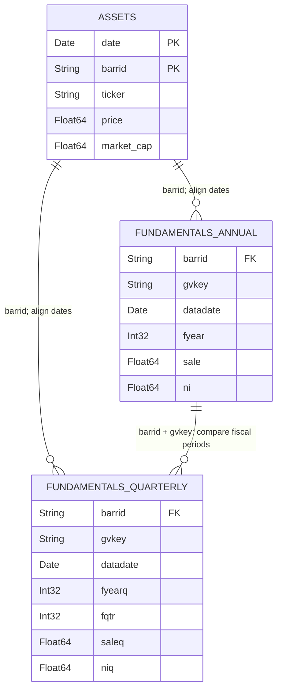

# Fundamentals query table

This reference describes the derived Compustat fundamentals tables built by `pipelines/fundamentals_query.py`. They are Polars/Parquet query tables with annual and quarterly frequency variants. A row is a stock (`barrid`) mapped to a Compustat company (`gvkey`) for a reported fiscal period (`datadate`); it is not a daily point-in-time panel. Values can be null when Compustat did not report a field.

The materializer uses the validated `INDL` / `C` / `D` / `STD` series. Annual and quarterly rows are stored separately. See `pipelines/utils/fundamentals_schema.py` for the canonical field names and Polars types.

## Columns shared by both tables

| Column(s) | Polars type | Meaning |
|---|---|---|
| `barrid`, `gvkey` | `String` | Barra security identifier and Compustat company identifier. |
| `datadate`, `rdq` | `Date` | Fiscal period end and report date, respectively. |
| `fyr` | `Int32` | Compustat fiscal year end month. |
| `currency` | `String` | Report currency. |
| `indfmt`, `consol`, `popsrc`, `datafmt` | `String` | Compustat format selectors (materialized as `INDL`, `C`, `D`, `STD`). |
| `mapping_status`, `barra_mapping_status` | `String` | Status of company and Barra mapping. |
| `mapping_date` | `Date` | Date associated with the selected mapping. |
| `compustat_efffrom`, `compustat_effthru` | `Date` | Effective interval for the Compustat mapping. |
| `barra_start_date`, `barra_end_date` | `Date` | Effective interval for the Barra mapping. |
| `mapping_snapshot_id`, `mapping_snapshot_path`, `mapping_provenance`, `mapping_relationships_json` | `String` | Mapping snapshot identity, location, provenance and relationship details. |
| `source_snapshot_id`, `source_report_path`, `source_balance_sheet_path`, `source_income_statement_path`, `source_cash_flow_path`, `source_capital_metrics_path` | `String` | Source snapshot and archived input paths. |
| `source_field_definitions_json` | `String` | Source definitions/metadata for fields. |
| `materialization_id` | `String` | ID of the derived table build. |

Annual additionally has `fyear: Int32`. Quarterly additionally has `fyearq: Int32` and `fqtr: Int32`.

## Financial fields

Financial values are `Float64`. Names follow Compustat mnemonics. The lists below are the exact fields materialized, not every field available in Compustat.

| Topic | Annual columns | Quarterly columns |
|---|---|---|
| Balance sheet and liquidity | `at`, `act`, `che`, `rect`, `invt`, `ppent`, `lct`, `dlc`, `dltt`, `lt`, `seq` | `atq`, `actq`, `cheq`, `rectq`, `invtq`, `ppentq`, `lctq`, `dlcq`, `dlttq`, `ltq`, `seqq` |
| Income statement and earnings | `sale`, `cogs`, `gp`, `xrd`, `xsga`, `oiadp`, `xint`, `txt`, `ni`, `epspx`, `epsfx`, `pi`, `dp` | `saleq`, `cogsq`, `gpq`, `xrdq`, `xsgaq`, `oiadpq`, `xintq`, `txtq`, `niq`, `epspxq`, `epsfxq`, `piq`, `dpq` |
| Cash flow and investment | `oancf`, `ivncf`, `fincf`, `capx`, `dpc`, `chech` | `oancfy`, `ivncfy`, `fincfy`, `capxy`, `dpcy`, `chechy` |
| Dividends and stock repurchases | `cdvc`, `pdvc`, `dltis`, `dltr`, `dlcch`, `prstkc`, `prstkcc`, `prstkpc`, `dvpsp_f`, `dvpsx_f`, `dvc`, `dvp`, `dvt`, `dvpd` | `cdvcy`, `pdvcy`, `dltisy`, `dltry`, `dlcchy`, `prstkcy`, `prstkccy`, `prstkpcy`, `dvpspq`, `dvpsxq`, `dvpq` |
| Shares | `csho`, `cshpri`, `cshfd` | `cshoq`, `cshprq`, `cshfdq` |

### What the financial fields mean

The descriptions below apply to both frequencies. A quarterly name ending in `q` is the quarterly version of the matching annual field where one exists; `y` fields are described separately because they are year-to-date. Values in millions are in the row's `currency`; per-share values are in that currency per share. Share counts are in millions of shares.

| Field | Meaning |
|---|---|
| `at` / `atq` | Total assets at period end. |
| `act` / `actq` | Current assets at period end. |
| `che` / `cheq` | Cash and short-term investments at period end. |
| `rect` / `rectq` | Receivables at period end. |
| `invt` / `invtq` | Inventories at period end. |
| `ppent` / `ppentq` | Net property, plant, and equipment at period end. |
| `lct` / `lctq` | Current liabilities at period end. |
| `dlc` / `dlcq` | Debt in current liabilities at period end. |
| `dltt` / `dlttq` | Long-term debt at period end. |
| `lt` / `ltq` | Total liabilities at period end. |
| `seq` / `seqq` | Stockholders' equity at period end. |
| `sale` / `saleq` | Net sales or turnover during the period. |
| `cogs` / `cogsq` | Cost of goods sold during the period. |
| `gp` / `gpq` | Gross profit during the period. |
| `xrd` / `xrdq` | Research and development expense during the period. |
| `xsga` / `xsgaq` | Selling, general, and administrative expense during the period. |
| `oiadp` / `oiadpq` | Operating income after depreciation during the period. |
| `xint` / `xintq` | Interest and related expense during the period. |
| `txt` / `txtq` | Income taxes during the period. |
| `ni` / `niq` | Net income or loss during the period. |
| `epspx` / `epspxq` | Basic earnings per share, excluding extraordinary items. |
| `epsfx` / `epsfxq` | Diluted earnings per share, excluding extraordinary items. |
| `pi` / `piq` | **Pretax income**: operating and nonoperating income before income tax expense and minority interest, subject to Compustat's item rules. |
| `dp` / `dpq` | Depreciation and amortization during the period. |
| `oancf` | Net cash flow from operating activities for the fiscal year. |
| `oancfy` | Net cash flow from operating activities, fiscal year to date. |
| `ivncf` | Net cash flow from investing activities for the fiscal year. |
| `ivncfy` | Net cash flow from investing activities, fiscal year to date. |
| `fincf` | Net cash flow from financing activities for the fiscal year. |
| `fincfy` | Net cash flow from financing activities, fiscal year to date. |
| `capx` | Capital expenditures for the fiscal year. |
| `capxy` | Capital expenditures, fiscal year to date. |
| `dpc` | Depreciation and amortization from the annual cash-flow statement. |
| `dpcy` | Depreciation and amortization from the cash-flow statement, fiscal year to date. |
| `chech` | Increase or decrease in cash and cash equivalents for the fiscal year. |
| `chechy` | Increase or decrease in cash and cash equivalents, fiscal year to date. |
| `cdvc` | Cash dividends on common stock from the annual cash-flow statement. |
| `cdvcy` | Cash dividends on common stock, fiscal year to date. |
| `pdvc` | Cash dividends on preferred stock from the annual cash-flow statement. |
| `pdvcy` | Cash dividends on preferred stock, fiscal year to date. |
| `dltis` | Long-term debt issuance during the fiscal year. |
| `dltisy` | Long-term debt issuance, fiscal year to date. |
| `dltr` | Long-term debt reduction during the fiscal year. |
| `dltry` | Long-term debt reduction, fiscal year to date. |
| `dlcch` | Net change in current debt; issuance and repayment are not split. |
| `dlcchy` | Net change in current debt, fiscal year to date; issuance and repayment are not split. |
| `prstkc` | Purchases of common and preferred stock, combined source item. |
| `prstkcy` | Purchases of common and preferred stock, fiscal year to date. |
| `prstkcc` | Purchases of common stock from the cash-flow statement. |
| `prstkccy` | Purchases of common stock from the cash-flow statement, fiscal year to date. |
| `prstkpc` | Purchases of preferred stock from the cash-flow statement. |
| `prstkpcy` | Purchases of preferred stock from the cash-flow statement, fiscal year to date. |
| `csho` / `cshoq` | Common shares outstanding at period end; excludes treasury shares. |
| `cshpri` / `cshprq` | Weighted-average common shares used to calculate basic EPS; not period-end shares outstanding. |
| `cshfd` / `cshfdq` | Shares used to calculate diluted EPS, including dilutive potential shares where applicable; not period-end shares outstanding. |
| `dvpsp_f` | Annual dividends per share based on payable date. |
| `dvpsx_f` | Annual dividends per share based on ex-date. |
| `dvpspq` | Quarterly dividends per share based on payable date. |
| `dvpsxq` | Quarterly dividends per share based on ex-date. |
| `dvc` | Common dividends declared during the year, as reported on the stockholders' equity statement. |
| `dvp` | Preferred dividend requirements and dividends paid on noncumulative preferred stock, as reported on the stockholders' equity statement. |
| `dvt` | Compustat total dividends item; distinct from cash dividends paid. |
| `dvpq` | Quarterly preferred dividend item; distinct from cash-flow dividends paid. |
| `dvpd` | Total cash dividends paid for common and preferred stock during the fiscal year. |

For quarterly cash flow/dividend/investing fields ending in `y` (for example `oancfy`, `capxy`, `dltisy`), the source field is year-to-date. The table retains those source values; use care when comparing them to discrete-quarter income statement values.

## Query with Polars

Read the saved development tables through the project's `Database` helper. `read()` returns a lazy Polars frame; call `collect()` to load it:

```python
from pipelines.utils.enums import DatabaseName
from pipelines.utils.tables import Database

db = Database(DatabaseName.DEVELOPMENT)
annual = db.fundamentals_annual_table.read().collect()
quarterly = db.fundamentals_quarterly_table.read().collect()
```

Example: inspect available columns, then get a stock's annual history:

```python
import polars as pl

print(annual.columns)

history = (
    annual
    .filter(pl.col("barrid") == "YOUR_BARRA_ID")
    .select("barrid", "gvkey", "datadate", "fyear", "currency", "sale", "ni", "at", "oancf")
    .sort("datadate")
)
```

Example: find each stock's **lowest annual net profit margin** in the latest ten years in the saved table. Net profit margin is net income divided by sales. This excludes missing values and nonpositive sales, keeps losses as negative margins, and returns the fiscal year that had the low:

```python
cutoff = annual.select(pl.col("datadate").max()).item().replace(year=annual.select(pl.col("datadate").max()).item().year - 9)

lowest_margin = (
    annual
    .filter(
        (pl.col("datadate") >= cutoff)
        & pl.col("sale").is_not_null()
        & (pl.col("sale") > 0)
        & pl.col("ni").is_not_null()
    )
    .with_columns((pl.col("ni") / pl.col("sale")).alias("net_profit_margin"))
    .sort(["barrid", "net_profit_margin", "datadate"])
    .group_by("barrid", maintain_order=True)
    .first()
    .select("barrid", "gvkey", "datadate", "fyear", "currency", "sale", "ni", "net_profit_margin")
    .sort("net_profit_margin")
)

print(lowest_margin.head(10))  # Ten stocks with the lowest observed margin
```

Example: filter by period and compute a simple ratio:

```python
margin = (
    annual
    .filter(pl.col("datadate") >= pl.date(2020, 1, 1))
    .with_columns((pl.col("ni") / pl.col("sale")).alias("net_margin"))
    .select("barrid", "datadate", "sale", "ni", "net_margin")
)
```

This is an example calculation, not a precomputed table field. It uses the latest date present in the saved data as its anchor, so rerunning it after a refresh moves the window forward. For a selected universe, filter `barrid` to those IDs before sorting. Multiple rows may exist for a stock over time, so retain fiscal labels when grouping. The canonical logical keys are available from `fundamentals_table_keys("annual")` or `fundamentals_table_keys("quarterly")`.

## How the tables link



`assets` is the daily security table, keyed by (`date`, `barrid`); it provides identifiers such as ticker and market data. The fundamentals tables are separate frequency-specific histories. Both carry `barrid` and `gvkey`, but their rows are reported fiscal periods and should not be joined to each other as if they were one-to-one. Match fundamentals to a daily asset row by `barrid` and an explicitly chosen date rule, usually the latest fundamentals `datadate` on or before the asset date. This is a date alignment convenience, not proof the report was public on that date: these tables contain current Compustat data, not point-in-time filing availability.

The annual table's logical key includes `barrid`, `gvkey`, `datadate`, format fields, `fyear`, `fyr`, mapping/snapshot IDs, and `materialization_id`. The quarterly key substitutes `fyearq` and `fqtr` for `fyear`. These keys allow multiple fiscal identities or mappings to be retained; don't assume `barrid` alone uniquely identifies one row.

Each fundamentals row also carries mapping and source provenance. `mapping_snapshot_id` points to the mapping snapshot represented in the build; `source_snapshot_id` and the `source_*_path` columns identify the Compustat report and statement artifacts. They are lineage fields embedded in the query table, not foreign keys to another table in `Database`.

Example: join the latest annual fundamentals on or before one asset snapshot date:

```python
from datetime import date

asset_date = date(2025, 12, 31)
assets = db.assets_table.read(asset_date.year).collect().filter(pl.col("date") == asset_date)

fundamentals_asof = (
    annual
    .filter(pl.col("datadate") <= asset_date)
    .sort(["barrid", "datadate"])
    .group_by("barrid", maintain_order=True)
    .last()
)

stock_snapshot = assets.join(
    fundamentals_asof.select("barrid", "gvkey", "datadate", "fyear", "sale", "ni", "at"),
    on="barrid",
    how="left",
)
```

For production joins, check fiscal identities and mapping multiplicity before collapsing rows; if a `barrid` has more than one `gvkey` or multiple rows for the selected period, resolve that ambiguity explicitly.
